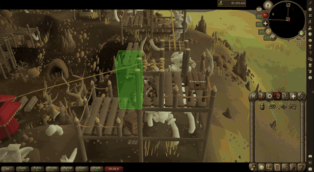
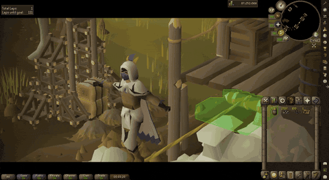
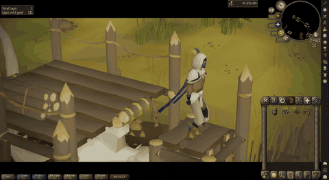
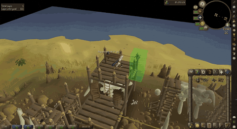
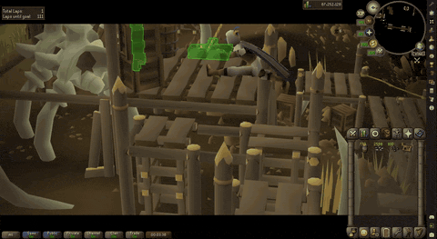

# Agility Action Camera

Action-movie camera work for OSRS agility. When you start a long obstacle, such
as a zipline, tightrope, leap or monkey bars, the camera cuts to a close
cinematic shot and letterbox bars slide in. Just before you land, it hands the
camera back so you can click the next obstacle without waiting.



| Tightrope | Hops |
|---|---|
|  |  |
| **Leap** | **Hand-back** |
|  |  |

## How it works

- **Detects long movements, not clicks.** A shot starts when the game is
  actually moving you through an obstacle: sliding, leaping or balancing.
  Obstacles that chain on from one click, like a tightrope that leads into a
  run of hops, are followed without another click. Short steps and ladders are
  left alone.
- **Directs every shot live.** A director scores each enabled shot on both
  sides of your path for how well it fits the obstacle, whether terrain blocks
  the view, and variety. It then plans again as the rest of the path comes
  into view. Nothing is pre-recorded and no camera positions are stored.
- **Gives the camera back early.** Each obstacle's duration is measured in game
  ticks the first time you run it. After that, the camera is handed back a set
  number of ticks before you land (two by default). On a first run it hands
  back on landing, or near the end of a zipline or leap.
- **Stays out of your way.** Moving the camera yourself or taking damage hands
  control back at once. Time spent between obstacles, or AFK, has no effect.

## Shots

| Shot | What it does |
|---|---|
| Tracking | Side-on dolly alongside you |
| Chase | Low, over the shoulder, looking down the line |
| Flyby | Starts ahead of you and whips round as you pass |
| Crane | Rising or falling move on drops and climbs |
| Orbit | Slow orbit around you |
| Hero | Low, tight angle looking up at you |
| Establishing | Wide view of the whole obstacle |

The **Shot style** setting picks the overall feel. **Action** (the default)
favours Hero, Chase and Flyby with tight framing and a subtle handheld wobble.
**Balanced** is in between. **Scenic** prefers wide, composed shots that show
off the course.

## Settings

| Section | What you can change |
|---|---|
| Triggers | Minimum distance and duration, chance per obstacle, chained obstacles, walk-style obstacles such as tightropes, ladders and climbs |
| Shots | Shot style, each shot on or off, when to cut on long obstacles |
| Feel | Responsiveness, hand back early (ticks), hold after landing, return time, auto-framing, handheld shake, letterbox, vignette, shot name |
| Interruptions | Whether your camera input or damage ends a shot |

## Rules

- While a shot is playing, the camera is detached from your character, so
  clicks on the game world are dropped, as
  [Jagex's third-party client guidelines](https://secure.runescape.com/m=news/third-party-client-guidelines?oldschool=1)
  forbid world interaction from a detached camera. On hand-back the camera
  reattaches straight away, so the next click goes through.
- Shots are computed live; no camera presets are stored
  ([RuneLite rejects those](https://github.com/runelite/runelite/wiki/Rejected-or-Rolled-Back-Features)).
- The plugin never sends input or server actions.

## Development

Requires a JDK 11 or newer (17 recommended).

```
./gradlew test   # unit tests for detection, shots and camera math
./gradlew run    # developer client with the plugin loaded
```

The **Debug** section has an overlay that draws detected paths, a hotkey that
plays a test orbit without running a lap, and logging for detection and raw
camera values.

Tuned on the Colossal Wyrm course; other courses rely on the generic
detection. Obstacle tables are copied from the core Agility plugin and need
re-syncing when new courses come out.
